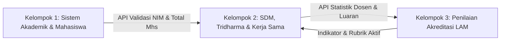
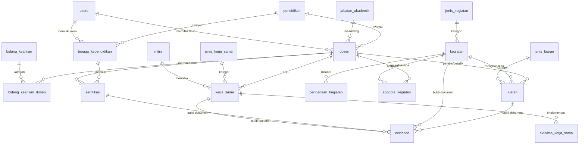

# Sistem Akreditasi LAM INFOKOM 2.1 — Modul K2
### Sumber Daya Manusia (SDM), Penelitian, PkM, & Kerja Sama

[](https://laravel.com)
[](https://php.net)
[](https://mysql.com)
[](https://pestphp.com)
[](LICENSE)

Aplikasi backend berbasis RESTful API untuk mendukung **Sistem Informasi Akreditasi Program Studi (PBL Semester 3)** yang mengacu pada instrumen **LAM INFOKOM Versi 2.1**. 

Repositori ini dikembangkan secara khusus oleh **Kelompok 2 (K2)** yang bertanggung jawab penuh terhadap pengelolaan Sumber Daya Manusia (Dosen Tetap Program Studi / DTPS & Tenaga Kependidikan), pelaksanaan kegiatan Tri Dharma Perguruan Tinggi (Penelitian & Pengabdian kepada Masyarakat), Luaran Ilmiah (Jurnal, Prosiding, HKI, Buku, Produk Teknologi), Kemitraan Kerja Sama, Pengelolaan Bukti Dukung (*Evidence*), serta Analitik Akreditasi.

---

## 📌 Daftar Isi
1. [Ruang Lingkup & Peran Kelompok 2](#-ruang-lingkup--peran-kelompok-2)
2. [Fitur Utama & 13 Checklist Kebutuhan](#-fitur-utama--13-checklist-kebutuhan)
3. [Arsitektur Database (Revisi ERD)](#-arsitektur-database-revisi-erd)
4. [Tech Stack & Prasyarat Sistem](#-tech-stack--prasyarat-sistem)
5. [Panduan Instalasi & Menjalankan Proyek](#-panduan-instalasi--menjalankan-proyek)
6. [Kredensial Akun Default (Hasil Seeder)](#-kredensial-akun-default-hasil-seeder)
7. [Pengujian Otomatis (Automated Testing)](#-pengujian-otomatis-automated-testing)
8. [Dokumentasi Lengkap API](#-dokumentasi-lengkap-api)

---

## 🏛 Ruang Lingkup & Peran Kelompok 2

Dalam pembagian arsitektur sistem akreditasi bersama:
* **Kelompok 1 (K1)**: Mengelola Core Akademik, Mahasiswa Baru, Kelulusan Tepat Waktu, IPK, Prestasi Mahasiswa, dan Kurikulum.
* **Kelompok 2 (K2 - Repositori Ini)**: Mengelola Profil SDM (Dosen DTPS/DTT & Tendik), Sertifikasi Kompetensi, Kegiatan Tri Dharma, Luaran Ilmiah, Kerja Sama & Implementasi, Evidence Drive, serta Interoperabilitas Data Mahasiswa K1 & Evaluasi K3.
* **Kelompok 3 (K3)**: Mengelola Master Instrumen LAM INFOKOM 2.1, Kriteria, Subkriteria, Indikator, Rubrik Penilaian, Bobot, dan Rekapitulasi Skor Akreditasi.



---

## ✨ Fitur Utama & 13 Checklist Kebutuhan

Sistem ini telah mengimplementasikan 13 kebutuhan fungsional baku sesuai standar penilaian:

1. **Validasi NIM Mahasiswa via API K1** (`POST /api/k1/validasi-nim`): Memverifikasi keabsahan NIM mahasiswa anggota kegiatan penelitian/PkM secara real-time ke sistem K1.
2. **Pencatatan Aktivitas Implementasi Kerja Sama** (`POST /api/kerja-sama/{id}/aktivitas`): Mencatat riwayat implementasi turunan dokumen MoU/MoA/IA.
3. **Input Link Drive & Validasi Format URL** (`POST /api/evidence`): Validasi regex khusus format Google Drive/Docs beserta deteksi duplikasi tautan.
4. **Workflow Validasi Evidence oleh Kaprodi** (`POST /api/evidence/{id}/validasi`): Siklus status persetujuan dokumen (*Menunggu Validasi*, *Valid*, *Ditolak*, *Perlu Perbaikan*) terintegrasi notifikasi in-app otomatis.
5. **Repository Evidence & Fitur Ganti Link** (`POST /api/evidence/{id}/ganti-link`): Manajemen arsip link lama di `evidence_histories` saat dilakukan revisi dokumen bukti.
6. **Konfigurasi Metrik & Evaluasi Kriteria LAM** (`assessment_hasil` & `konfigurasi_metrik`): Engine penilaian gap capaian terhadap ambang batas rubrik instrumen LAM INFOKOM.
7. **Kalkulasi Rasio Dosen : Mahasiswa** (`GET /api/v1/rasio-dosen-mahasiswa`): Menghitung rasio dosen DTPS terhadap jumlah mahasiswa aktif dari API K1.
8. **Kalkulasi Produktivitas Dosen** (`GET /api/v1/produktivitas-dosen`): Rata-rata luaran ilmiah dan kegiatan Tri Dharma per dosen DTPS.
9. **Engine Gap Analysis SDM & Rekomendasi**: Menghitung deviasi skor capaian dan menghasilkan rekomendasi otomatis.
10. **Dashboard Analitik & Tren TS-n** (`GET /api/v1/tren-tridharma` & `/api/v1/dashboard`): Visualisasi tren 5 tahun (TS-4 s/d TS) untuk publikasi, PkM, penelitian, dan kemitraan.
11. **Pencatatan Audit Trail / Mutasi Data** (`audit_logs`): Perekaman otomatis setiap aksi `CREATE`, `UPDATE`, `DELETE`, dan `VALIDATE`.
12. **Sistem Notifikasi In-App** (`notifikasi`): Pemberitahuan real-time untuk penolakan evidence atau permintaan revisi.
13. **Perpanjangan & Reminder Masa Berlaku Kerja Sama** (`POST /api/kerja-sama/{id}/perpanjang`): Pemantauan tanggal kedaluwarsa dokumen kemitraan.

---

## 🗄 Arsitektur Database (Revisi ERD)

Database menggunakan pendekatan **Unified Activities & Outputs** yang modular:
* **Kegiatan Terpadu (`kegiatan`)**: Menyatukan Penelitian & PkM dalam satu struktur tabel yang fleksibel dengan relasi ke `pendanaan_kegiatan` dan `anggota_kegiatan` (Dosen/Mahasiswa).
* **Luaran Komprehensif (`luaran`)**: Menampung data Buku Ajar, Artikel Jurnal, Prosiding Seminar, Sertifikat HKI, dan Produk Teknologi TKT.
* **Multi-Entity Evidence (`evidence`)**: Tautan langsung ke `kerja_sama`, `sertifikasi`, `kegiatan`, dan `luaran`.



---

## 💻 Tech Stack & Prasyarat Sistem

* **Bahasa Pemrograman**: PHP >= 8.2
* **Framework**: Laravel 12.x
* **Database**: MySQL 8.0+ / MariaDB 10.4+
* **Autentikasi**: JWT (JSON Web Token) / Laravel Sanctum
* **Testing Framework**: Pest PHP 3.x
* **Tools Pendukung**: Composer 2.x, Git

---

## 🚀 Panduan Instalasi & Menjalankan Proyek

### 1. Klon Repositori
```bash
git clone https://github.com/mufadah/akreditasi-pbl.git
cd akreditasi-pbl
```

### 2. Pasang Dependensi PHP
```bash
composer install
```

### 3. Konfigurasi Lingkungan (`.env`)
Salin file `.env.example` ke `.env`:
```bash
copy .env.example .env
```
Sesuaikan konfigurasi database Anda di dalam `.env`:
```env
DB_CONNECTION=mysql
DB_HOST=127.0.0.1
DB_PORT=3306
DB_DATABASE=laravel
DB_USERNAME=root
DB_PASSWORD=
```

### 4. Buat Application Key & JWT Secret
```bash
php artisan key:generate
```
Pastikan kunci JWT terisi di `.env`:
```env
JWT_SECRET=3Qs5g0nA9rxpXGIXI9OdVLVKZrVkMcIIn7KS6avl6z5nHhYVH25IcUIYotidfatU
JWT_ALGO=HS256
```

### 5. Migrasi & Seeding Database
Jalankan migrasi fresh beserta data seed master awal:
```bash
php artisan migrate:fresh --seed
```

### 6. Jalankan Local Development Server
```bash
php artisan serve
```
Server API akan aktif pada: **`http://localhost:8000`**

---

## 🔑 Kredensial Akun Default (Hasil Seeder)

Gunakan akun default berikut untuk pengujian autentikasi (`POST /api/login`):

| Role | Email | Password | Hak Akses |
|:---|:---|:---|:---|
| **ADMINISTRATOR** | `admin@polines.ac.id` | `password123` | Akses penuh seluruh master data, CRUD, dan analitik. |
| **KAPRODI** | `kaprodi.trpl@polines.ac.id` | `password123` | Validasi evidence dan monitoring dashboard analitik. |
| **DOSEN** | `dosen@polines.ac.id` | `password123` | Input kegiatan, luaran, dan pengunggahan evidence. |

---

## 🧪 Pengujian Otomatis (Automated Testing)

Aplikasi telah dilengkapi unit & feature testing menggunakan **Pest PHP**. Jalankan pengujian kapan saja dengan:

```bash
php artisan test
```

---

## 📖 Dokumentasi Lengkap API

Seluruh rute REST API, format Request/Response JSON, dan header autentikasi didokumentasikan secara rinci pada file:
👉 **[API_DOCUMENTATION.md](file:///d:/File%20Umum%20Kuliah/File%20Kuliah%20Sem.3/akreditasi-pbl/API_DOCUMENTATION.md)**

---

*Dikembangkan dengan dedikasi untuk Project Based Learning (PBL) Akreditasi LAM INFOKOM 2.1 — Jurusan Teknik Elektro, Politeknik Negeri Semarang.*
