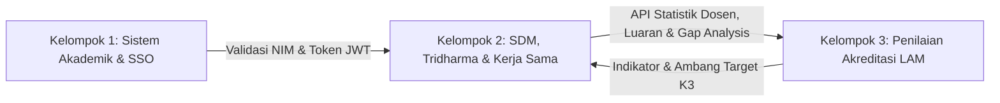
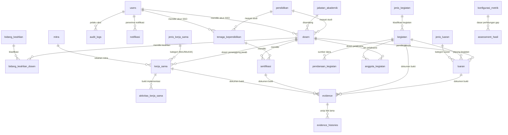

# Sistem Akreditasi LAM INFOKOM 2.1 — Modul K2
### Sumber Daya Manusia (SDM), Penelitian, PkM, & Kerja Sama

[](https://laravel.com)
[](https://php.net)
[](https://mysql.com)
[](https://pestphp.com)
[](LICENSE)

Aplikasi backend berbasis RESTful API untuk mendukung **Sistem Informasi Akreditasi Program Studi (PBL Semester 3)** yang mengacu pada instrumen **LAM INFOKOM Versi 2.1**. 

Repositori ini dikembangkan secara khusus oleh **Kelompok 2 (K2)** yang bertanggung jawab penuh terhadap pengelolaan Sumber Daya Manusia (Dosen Tetap Program Studi / DTPS & Tenaga Kependidikan), pelaksanaan kegiatan Tri Dharma Perguruan Tinggi (Penelitian & Pengabdian kepada Masyarakat), Luaran Ilmiah (Jurnal, Prosiding, HKI, Buku, Produk Teknologi), Kemitraan Kerja Sama, Pengelolaan Bukti Dukung (*Evidence*), serta Analitik Akreditasi.

---

## 📌 Daftar Isi
1. [Ruang Lingkup & Peran Kelompok 2](#-ruang-lingkup--peran-kelompok-2)
2. [Status Checklist 12 Tugas Pengembangan (100% Selesai)](#-status-checklist-12-tugas-pengembangan-100-selesai)
3. [Pemetaan 16 Fitur & Flowchart Sistem](#-pemetaan-16-fitur--flowchart-sistem)
4. [Arsitektur Database (Analisis ERD Terbaru & Eliminasi Redundansi)](#-arsitektur-database-analisis-erd-terbaru--eliminasi-redundansi)
5. [Tech Stack & Prasyarat Sistem](#-tech-stack--prasyarat-sistem)
6. [Panduan Instalasi & Menjalankan Proyek](#-panduan-instalasi--menjalankan-proyek)
7. [Kredensial Akun Default (Hasil Seeder)](#-kredensial-akun-default-hasil-seeder)
8. [Pengujian Otomatis (Automated Testing)](#-pengujian-otomatis-automated-testing)
9. [Dokumentasi Lengkap RESTful API](#-dokumentasi-lengkap-restful-api)

---

## 🏛 Ruang Lingkup & Peran Kelompok 2

Dalam pembagian arsitektur sistem akreditasi bersama:
* **Kelompok 1 (K1)**: Mengelola Core Akademik, Mahasiswa Baru, Kelulusan Tepat Waktu, IPK, Prestasi Mahasiswa, serta penyedia Single Sign-On (SSO Auth Server).
* **Kelompok 2 (K2 - Repositori Ini)**: Mengelola Profil SDM (Dosen DTPS/DTT & Tendik), Sertifikasi Kompetensi, Kegiatan Tri Dharma Terpadu, Luaran Ilmiah, Kemitraan Kerja Sama, Pengelolaan Bukti Dukung (*Evidence*), serta Analitik Akreditasi & Gap Analysis.
* **Kelompok 3 (K3)**: Mengelola Master Instrumen LAM INFOKOM 2.1, Kriteria, Subkriteria, Indikator, Rubrik Penilaian, Bobot, dan Rekapitulasi Skor Akreditasi.



---

## ✅ Status Checklist 12 Tugas Pengembangan (100% Selesai)

Seluruh 12 fitur pada checklist pengembangan telah berhasil diselesaikan dan teruji:

- [x] **Konfigurasi metrik & indikator LAM (API K3)**: CRUD dan sinkronisasi indikator K3 via `GET /api/konfigurasi-metrik/indikator-k3` dan `KonfigurasiMetrikController`.
- [x] **Kalkulasi rasio Dosen : Mahasiswa (API K1)**: Perhitungan rasio DTPS terhadap mahasiswa aktif via `GET /api/v1/rasio-dosen-mahasiswa`.
- [x] **Kalkulasi produktivitas dosen**: Perhitungan rasio publikasi, penelitian, dan PkM per dosen DTPS via `GET /api/v1/produktivitas-dosen`.
- [x] **Engine Gap Analysis SDM & rekomendasi**: Engine kalkulasi deviasi capaian riil vs ambang target kriteria LAM dengan rekomendasi taktis via `POST /api/assessment/run` & `GET /api/assessment/hasil`.
- [x] **Dashboard analitik & tren TS-n**: Agregasi tren multi-tahun (TS-4 s/d TS) untuk penelitian, PkM, luaran, dan kemitraan via `GET /api/v1/dashboard` & `GET /api/v1/tren-tridharma`.
- [x] **Middleware Auth API Key / Token**: Dual Authentication mendukung otorisasi Bearer JWT (SSO K1) dan header `X-API-KEY` pada `JwtAuthenticate`.
- [x] **Endpoint GET /api/v1/dosen/statistik**: Statistik demografi, status DTPS/DTT, jabatan akademik, dan sebaran jenjang pendidikan dosen.
- [x] **Endpoint GET /api/v1/tridharma/summary**: Rekapitulasi kuantitas kegiatan penelitian, PkM, dan luaran ilmiah berbasis tahun laporan.
- [x] **Endpoint GET /api/v1/kerjasama/aktif**: Rekap dan daftar kerja sama berstatus aktif dengan filter pencarian dan relasi lengkap.
- [x] **Catat audit log mutasi data**: Audit trail otomatis mencatat mutasi `CREATE`, `UPDATE`, `DELETE`, dan `VALIDATE` ke tabel `audit_logs` via `AuditLogController` & `AuditLogService`.
- [x] **Kirim notifikasi in-app**: Pengiriman notifikasi berbasis user atau role secara real-time via `POST /api/notifikasi` dan `NotifikasiService`.
- [x] **Reminder otomatis kedaluwarsa kerja sama**: Endpoint monitoring `GET /api/kerja-sama/reminder-kedaluwarsa`, sinkronisasi status otomatis `POST /api/kerja-sama/check-kedaluwarsa`, dan Command CLI `php artisan kerjasama:check-kedaluwarsa` terjadwal harian pukul 01:00 WIB.

---

## 🗺 Pemetaan 16 Fitur & Flowchart Sistem

Pengembangan dibagi ke dalam 16 alur kerja terstruktur:

### A. Fitur 1 s/d 8 (Modul Master Data & Evidence — Rekan Tim)
1. **Fitur 1**: Pengelolaan Master Dosen DTPS & DTT (CRUD, Import Excel, Soft Deletes, Guard Relasi Kegiatan/Evidence).
2. **Fitur 2**: Pengelolaan Tenaga Kependidikan / Tendik (CRUD, Kualifikasi, Soft Deletes).
3. **Fitur 3**: Pengunggahan Evidence Bukti Dukung (Validasi URL Google Drive, Cek Duplikasi).
4. **Fitur 4**: Workflow Validasi Evidence (Approval Kaprodi/Asesor: Menunggu, Valid, Ditolak, Perlu Perbaikan).
5. **Fitur 5**: Manajemen Riwayat & Ganti Link Evidence (`evidence_histories`).
6. **Fitur 6**: Pengelolaan Profil Mitra Kerja Sama (Kategori Nasional, Multinasional, Internasional).
7. **Fitur 7**: Kegiatan Tri Dharma Terpadu (`kegiatan`, `anggota_kegiatan`, `pendanaan_kegiatan`).
8. **Fitur 8**: Pengelolaan Luaran Ilmiah Komprehensif (`luaran` polimorfik: Buku, Jurnal, Prosiding, HKI, Produk).

### B. Fitur 9 s/d 16 (Modul Analitik, Interoperabilitas, Keamanan, & Otomasi — Tanggung Jawab Pengembang)
9. **Fitur 9**: Kalkulasi Rasio Dosen : Mahasiswa & Produktivitas Dosen (Interoperabilitas K1).
10. **Fitur 10**: Manajemen Masa Berlaku Kerja Sama, Perpanjangan, & Reminder Otomatis Kedaluwarsa.
11. **Fitur 11**: Dashboard Analitik Komposit & Tren TS-n (TS-4 s/d TS).
12. **Fitur 12**: Engine Gap Analysis SDM & Tri Dharma serta Rekomendasi Tindak Lanjut Akreditasi.
13. **Fitur 13**: Konfigurasi Metrik & Indikator Penilaian Standar LAM INFOKOM (API K3).
14. **Fitur 14**: Pencatatan & Monitoring Audit Log Mutasi Data (Audit Trail Forensik).
15. **Fitur 15**: Middleware Keamanan Dual-Auth (JWT SSO K1 & Shared API Key `X-API-KEY`).
16. **Fitur 16**: Layanan Notifikasi In-App Pengguna & Peringatan Otomatis Sistem.

---

## 🗄 Arsitektur Database (Analisis ERD Terbaru & Eliminasi Redundansi)

Berdasarkan tinjauan ERD terbaru, arsitektur database telah disederhanakan dan dibersihkan dari tabel-tabel legacy yang redundan:

### 1. Eliminasi Redundansi (Clean-up Schema):
* **Penyatuan Kegiatan (`kegiatan`)**: Mengeliminasi tabel terpisah `penelitian` dan `pkm`. Semua kegiatan Tri Dharma kini dikonsolidasikan ke tabel `kegiatan` dengan relasi `jenis_kegiatan`, `pendanaan_kegiatan`, dan `anggota_kegiatan` (mendukung kolaborasi Dosen dan Mahasiswa).
* **Penyatuan Luaran Ilmiah (`luaran`)**: Mengeliminasi tabel parsial `publikasi`, `buku`, dan `hki`. Seluruh kategori output akademik ditampung secara terpadu di tabel `luaran` dengan klasifikasi fleksibel melalui `jenis_luaran`.
* **Pembersihan Rute Redundan**: Rute legacy (`apiResource('penelitian')`, `pkm`, `publikasi`, `buku`, `hki`, `jenis-penelitian`, `jenis-publikasi`) dan duplikasi deklarasi rute `aktivitas-kerja-sama` di `routes/api.php` telah dihapus.

### 2. Diagram ERD Terbaru (Unified Schema):



---

## 💻 Tech Stack & Prasyarat Sistem

* **Bahasa Pemrograman**: PHP >= 8.2
* **Framework**: Laravel 12.x
* **Database**: MySQL 8.0+ / MariaDB 10.4+
* **Autentikasi**: JWT (JSON Web Token) / Laravel Sanctum
* **Testing Framework**: Pest PHP 3.x
* **Tools Pendukung**: Composer 2.x, Git

---

## 🚀 Panduan Instalasi & Menjalankan Proyek

### 1. Klon Repositori
```bash
git clone https://github.com/mufadah/akreditasi-pbl.git
cd akreditasi-pbl
```

### 2. Pasang Dependensi PHP
```bash
composer install
```

### 3. Konfigurasi Lingkungan (`.env`)
Salin file `.env.example` ke `.env`:
```bash
copy .env.example .env
```
Sesuaikan konfigurasi database Anda di dalam `.env`:
```env
DB_CONNECTION=mysql
DB_HOST=127.0.0.1
DB_PORT=3306
DB_DATABASE=laravel
DB_USERNAME=root
DB_PASSWORD=
```

### 4. Buat Application Key & JWT Secret
```bash
php artisan key:generate
```
Pastikan kunci JWT terisi di `.env`:
```env
JWT_SECRET=3Qs5g0nA9rxpXGIXI9OdVLVKZrVkMcIIn7KS6avl6z5nHhYVH25IcUIYotidfatU
JWT_ALGO=HS256
```

### 5. Migrasi & Seeding Database
Jalankan migrasi fresh beserta data seed master awal:
```bash
php artisan migrate:fresh --seed
```

### 6. Jalankan Local Development Server
```bash
php artisan serve
```
Server API akan aktif pada: **`http://localhost:8000`**

---

## 🔑 Kredensial Akun Default (Hasil Seeder)

Gunakan akun default berikut untuk pengujian autentikasi (`POST /api/login`):

| Role | Email | Password | Hak Akses |
|:---|:---|:---|:---|
| **ADMINISTRATOR** | `admin@polines.ac.id` | `password123` | Akses penuh seluruh master data, CRUD, dan analitik. |
| **KAPRODI** | `kaprodi.trpl@polines.ac.id` | `password123` | Validasi evidence dan monitoring dashboard analitik. |
| **DOSEN** | `dosen@polines.ac.id` | `password123` | Input kegiatan, luaran, dan pengunggahan evidence. |

---

## 🧪 Pengujian Otomatis (Automated Testing)

Aplikasi telah dilengkapi unit & feature testing menggunakan **Pest PHP**. Jalankan pengujian kapan saja dengan:

```bash
php artisan test
```

---

---

## 🔌 Ringkasan Endpoint Modul Analitik & Otomasi (Fitur 9 s/d 16)

Berikut adalah daftar endpoint utama untuk fitur-fitur yang dikembangkan:

| Fitur | Method | Endpoint | Deskripsi & Hak Akses |
|:---|:---:|:---|:---|
| **Fitur 9 (Rasio & Produktivitas)** | `GET` | `/api/v1/rasio-dosen-mahasiswa` | Rasio dosen DTPS terhadap mahasiswa aktif (Admin, Kaprodi, Asesor, Dosen) |
| | `GET` | `/api/v1/produktivitas-dosen` | Rata-rata publikasi dan tridharma per dosen DTPS |
| | `GET` | `/api/v1/dosen/statistik` | Demografi, sebaran status DTPS/DTT, jabatan, dan pendidikan dosen |
| | `GET` | `/api/v1/tridharma/summary` | Rekapitulasi volume kegiatan penelitian, PkM, dan luaran per tahun |
| **Fitur 10 (Kerja Sama & Reminder)** | `GET` | `/api/v1/kerjasama/aktif` | Daftar kerja sama yang saat ini berstatus Aktif |
| | `GET` | `/api/kerja-sama/reminder-kedaluwarsa` | Monitoring dokumen kerja sama yang telah atau akan kedaluwarsa dlm 30 hari |
| | `POST` | `/api/kerja-sama/check-kedaluwarsa` | Trigger sinkronisasi otomatis status kedaluwarsa & pengiriman notifikasi |
| | `POST` | `/api/kerja-sama/{id}/perpanjang` | Perpanjangan tanggal selesai kerja sama |
| | `CLI` | `php artisan kerjasama:check-kedaluwarsa` | Artisan Command terjadwal harian (pukul 01:00 WIB via scheduler) |
| **Fitur 11 (Dashboard & Tren TS-n)** | `GET` | `/api/v1/dashboard` | Dashboard analitik terpadu (ringkasan SDM, tridharma, mitra, dan tren) |
| | `GET` | `/api/v1/tren-tridharma` | Tren 5 tahun (TS-4 s/d TS) luaran, penelitian, PkM, dan kerja sama |
| **Fitur 12 (Gap Analysis & Rekomendasi)** | `POST` | `/api/assessment/run` | Eksekusi engine kalkulasi capaian vs target metrik kriteria LAM & generate rekomendasi |
| | `GET` | `/api/assessment/hasil` | Mengambil riwayat hasil gap analysis dan rekomendasi tindak lanjut |
| **Fitur 13 (Konfigurasi Metrik K3)** | `GET` | `/api/konfigurasi-metrik/indikator-k3` | Integrasi indikator kriteria akreditasi standar LAM INFOKOM dari K3 |
| | `CRUD` | `/api/konfigurasi-metrik` | Pengelolaan data ambang batas (target) dan formula indikator |
| **Fitur 14 (Audit Trail Log)** | `GET` | `/api/audit-logs` | Mengambil riwayat audit log mutasi data (CREATE, UPDATE, DELETE, VALIDATE) |
| | `GET` | `/api/audit-logs/{id}` | Detail log forensik mutasi data (payload nilai lama vs baru) |
| **Fitur 15 (Dual Authentication)** | `HEADER` | `Authorization: Bearer <TOKEN_JWT>` | Autentikasi pengguna SSO Kelompok 1 terverifikasi |
| | `HEADER` | `X-API-KEY: <API_KEY>` | Autentikasi server-to-server untuk microservice K1 & K3 |
| **Fitur 16 (Notifikasi In-App)** | `GET` | `/api/notifikasi` | Daftar notifikasi in-app pengguna terautentikasi (filter `unread_only`) |
| | `POST` | `/api/notifikasi` | Kirim notifikasi manual / sistem berdasarkan user ID atau role |
| | `POST` | `/api/notifikasi/{id}/baca` | Menandai satu notifikasi telah dibaca |
| | `POST` | `/api/notifikasi/baca-semua` | Menandai seluruh notifikasi pengguna telah dibaca |

---

## 📖 Dokumentasi Lengkap API

Seluruh rute REST API, format Request/Response JSON, dan header autentikasi didokumentasikan secara rinci pada file:
👉 **[API_DOCUMENTATION.md](file:///d:/File%20Umum%20Kuliah/File%20Kuliah%20Sem.3/akreditasi-pbl/API_DOCUMENTATION.md)**

---

*Dikembangkan dengan dedikasi untuk Project Based Learning (PBL) Akreditasi LAM INFOKOM 2.1 — Jurusan Teknik Elektro, Politeknik Negeri Semarang.*
